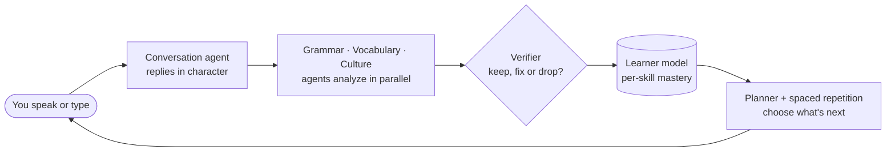

<div align="center">

# 🌍 Polyglot Swarm

### An AI language tutor that remembers what you know, and decides what you should practice next.

Have real conversations in any language. A team of AI agents quietly tracks your grammar and vocabulary, builds a model of your skills, and plans your next lesson.

[](https://github.com/NiravRVaghasiya/Polyglot-Swarm/actions/workflows/ci.yml)
[](https://www.python.org/downloads/)
[](LICENSE)
[](https://github.com/langchain-ai/langgraph)
[](#2-choose-how-the-tutor-thinks)

[**Quick start**](#quick-start) · [**How it works**](#how-it-works) · [**Docker**](#docker) · [**Docs**](#documentation) · [**Contributing**](#contributing)

</div>

---

## Why Polyglot Swarm?

Most AI chatbots forget you the moment the chat ends. Polyglot Swarm keeps a **learner model**: a running picture of what you can and can't do yet, skill by skill. Every conversation adds evidence to it, and it uses that picture to choose what you practice next.

```text
You:  Hola, yo soy hambre. Quiero una mesa para dos.
Ana:  ¡Claro! Pasen por aquí. ¿Qué les gustaría beber?
You:  quit

━━━━━━━━━━━━━━━━━━━━━━━━━━━━━━━━━━━━━━━━━━━━━━━━━━
📊 Session Report
━━━━━━━━━━━━━━━━━━━━━━━━━━━━━━━━━━━━━━━━━━━━━━━━━━
🔤 Grammar — 1 correction(s):
   • yo soy hambre → yo tengo hambre
📚 New vocabulary (2): mesa, beber
📈 Level estimate: not yet (insufficient evidence) · tutor working level A1
```

<sub>An example terminal session. The tutor stays in character during the chat; corrections are saved for the report at the end.</sub>

## Features

| Feature | What you get |
|---|---|
| 🎭 **Role-play conversations** | Order at a restaurant, see a doctor, do a job interview, or just chat, in any language you name. |
| 🤫 **Corrections that don't interrupt** | Grammar is checked in the background and only flagged when the tutor is confident. A wrong correction counts as worse than a missed one. |
| 🧠 **A learner model** | Tracks your grammar, vocabulary, speaking, listening, reading, writing and cultural skills from recorded evidence. Each skill has a mastery range and says how much evidence backs it. Task difficulty is taken into account, and repeated or duplicate judgments don't inflate the result. |
| 🗺️ **A plan for what's next** | Ranks what to practice by how much you'd learn from it, fitting in reviews that are due and the areas you're weakest in. |
| 🔁 **Spaced repetition** | New words from your conversations are scheduled for review with [FSRS](https://github.com/open-spaced-repetition/py-fsrs), so they come back just before you'd forget them. |
| 📊 **A per-skill CEFR level** | A level (A1–C2) for each skill once there is enough evidence. Until then the tutor says "not yet assessed" instead of guessing, and it suggests a short check to find out. |
| 🎙️ **Voice** | Speak to the tutor and hear it reply (Whisper speech recognition + Edge TTS). Optional; text works without it. |
| 🔒 **Private by design** | Run it entirely on your own machine with Ollama, or set `LOCAL_ONLY=true` so no learning data ever leaves it. |

## Quick start

About ten minutes. You need **Python 3.12+** ([download](https://www.python.org/downloads/)) and **Git**.

### 1. Install

**macOS / Linux**

```bash
git clone https://github.com/NiravRVaghasiya/Polyglot-Swarm.git
cd Polyglot-Swarm
python3.12 -m venv .venv
source .venv/bin/activate
python -m pip install -e ".[dev]"
cp .env.example .env
```

**Windows (PowerShell)**

```powershell
git clone https://github.com/NiravRVaghasiya/Polyglot-Swarm.git
cd Polyglot-Swarm
py -3.12 -m venv .venv
.venv\Scripts\Activate.ps1
python -m pip install -e ".[dev]"
copy .env.example .env
```

> [!TIP]
> In every new terminal, `cd` into the folder and run the `activate` line again before using `polyglot`. If PowerShell blocks `Activate.ps1`, use Command Prompt and run `.venv\Scripts\activate.bat` instead.

### 2. Choose how the tutor thinks

Open `.env` in a text editor and set up **one** option:

| Option | Good for | What to do |
|---|---|---|
| **A · Hosted AI** | The best conversations | Add one API key: `ANTHROPIC_API_KEY` ([get one](https://console.anthropic.com)), `GOOGLE_API_KEY` or `OPENAI_API_KEY`. |
| **B · Local AI (Ollama)** | Free and fully private | Install [Ollama](https://ollama.com) and run `ollama pull llama3.1:8b`. Needs ~8 GB of free memory; a GPU keeps replies fast. |
| **C · Offline demo** | Trying the interface | Set `POLYGLOT_DETERMINISTIC=1`. Replies are placeholders, not real AI. |

### 3. Check your setup

```bash
polyglot health
```

It tests your choice and ends with **Ready** when everything works. If something is missing, it prints a `fix:` line telling you exactly what to do.

### 4. Start learning

| Interface | Command | Open |
|---|---|---|
| 💬 Terminal chat | `polyglot chat --language Spanish` | — |
| 🌐 Web app (chat + voice) | `python -m src.main` | http://localhost:7860 |
| 🔌 REST API | `uvicorn src.api.app:app --reload` | http://localhost:8000/docs |
| 📈 React dashboard | Start the REST API, then `cd frontend/react_app`, `npm install`, `npm run dev` ([Node.js 20+](https://nodejs.org)) | http://localhost:3000 |

Type `quit` in the terminal chat to end the session and see your report. Run `polyglot scenarios` to list the role-plays, then start one with `polyglot chat --scenario es_restaurant_ordering`.

<details>
<summary><b>🛠️ Troubleshooting</b></summary>

<br>

| Problem | Fix |
|---|---|
| `pip` says the package requires Python `>=3.12` | Your virtual environment uses an older Python. Delete `.venv` and redo step 1. |
| `polyglot` is not recognized | Activate the virtual environment, or run `python -m src.cli` instead. |
| The tutor only says "Disculpa, no te escuché bien" | No AI backend is answering. Run `polyglot health` and follow its `fix:` line. |
| Replies start with `[fake:` | Offline demo mode is on. Set `POLYGLOT_DETERMINISTIC=0` once option A or B is set up. |
| Ollama: model `llama3.1:8b` not found | Run `ollama pull llama3.1:8b`, or set `LLM_LOCAL=ollama/<model>` to one from `ollama list`. |
| Ollama: out of memory | Set `OLLAMA_NUM_CTX=4096`, or use a smaller model (`ollama pull llama3.2:3b`, then `LLM_LOCAL=ollama/llama3.2:3b`). |
| React dashboard can't reach the server | Start the REST API on port 8000. Serving the dashboard from another address? Add it to `CORS_ORIGINS`. |
| "Address already in use" | Change `API_PORT` / `GRADIO_SERVER_PORT` in `.env`, or pass `--port 8001` to `uvicorn`. |
| Microphone or spoken replies don't work | Install the voice extra, `python -m pip install -e ".[voice]"`, plus [ffmpeg](https://ffmpeg.org/download.html). |

Every setting is documented in [`.env.example`](.env.example).

</details>

## How it works



1. **You talk.** The conversation agent answers in character, so the chat keeps flowing.
2. **Agents analyze.** Grammar, vocabulary and cultural agents study your message in the background.
3. **A verifier checks them.** Each finding is kept, fixed or dropped. Uncertain corrections are dropped rather than shown.
4. **Your learner model updates.** Kept findings become evidence about each of your skills.
5. **The next session adapts.** A planner picks what's most worth practicing, and words that are due for review come up in conversation.

More detail: [architecture](docs/architecture.md) and [learner model](docs/learner-model.md).

## Docker

Prefer containers? You only need [Docker Desktop](https://www.docker.com/products/docker-desktop/). Copy `.env.example` to `.env` and [choose a backend](#2-choose-how-the-tutor-thinks) first.

```bash
docker compose up --build                       # web app :7860 + REST API :8000
docker compose --profile web up --build         # + React dashboard :3000
docker compose --profile local-llm up --build   # + an Ollama container (option B)
```

With `local-llm`, pull the model once while it's running: `docker compose exec ollama ollama pull llama3.1:8b`. See [deployment](docs/deployment.md) for using an Ollama that's already on your machine.

## Languages

Name **any language** and the tutor will use it. **Spanish**, **Polish** and **Italian** also come with a **language pack** (grammar topics, word frequency lists, collocations, register notes, and cognates and false friends) plus **15 ready-made role-play scenarios**, such as ordering at a restaurant, the pharmacy and a job interview.

Adding a language pack is data, not code: see [language packs](docs/language-packs.md).

<details>
<summary><b>🧰 All CLI commands</b></summary>

<br>

| Command | What it does |
|---|---|
| `polyglot chat` | Start a conversation (`--language`, `--scenario`) |
| `polyglot health` | Check setup and that an AI backend answers |
| `polyglot scenarios` | List the role-play scenarios |
| `polyglot plan` | Today's plan: the next best things to practice, and why |
| `polyglot assess` | Your CEFR level for each skill, with its evidence status (or "not yet assessed") |
| `polyglot progress` | Streak, words learned, level and top weaknesses |
| `polyglot drill` | Practice drills from your weaknesses and due words |
| `polyglot write` | Detailed feedback on a piece of writing |
| `polyglot peer` | A two-speaker dialogue to listen to, with a comprehension check |
| `polyglot ingest` | Simplify outside text to your level and add its words to review |
| `polyglot trace` | Replay a session: every model call and finding, in order |
| `polyglot cost` | Model cost and latency for a session or user |
| `polyglot experiment` | Run controlled comparisons between variants |
| `polyglot privacy` | Export or delete your data |
| `polyglot security` | Backups and the audit log |
| `polyglot results` | Regenerate the measured results |

Add `--help` to any command for its options.

</details>

## Documentation

| Topic | What's inside |
|---|---|
| 🏗️ [Architecture](docs/architecture.md) | How the pieces fit together in code |
| 🧠 [Learner model](docs/learner-model.md) | How skills, evidence and confidence are tracked |
| 🤖 [LLM providers](docs/providers.md) | Model routing, retries and failover |
| 🚢 [Deployment](docs/deployment.md) | Running locally, with Docker, and in production |
| 🔒 [Privacy](docs/privacy.md) | What's stored, local-only mode and deleting data |
| 🌐 [Language packs](docs/language-packs.md) | Adding resources for a language |
| 🧪 [Evaluation](docs/evaluation.md) · [Results](docs/results.md) | Test harnesses and their latest numbers |
| 🔬 [Real-model evaluation](docs/real-model-evaluation.md) | How real LLMs score on the grammar and vocabulary benchmarks, and how to rerun them |
| 🧭 [Adaptive learning](docs/adaptive-learning.md) | How the tutor predicts performance, picks the next activity and difficulty, and how that was evaluated (in simulation) |
| 📝 [Decision records](docs/adr/README.md) | Why the system is built the way it is |

## Development

```bash
make check     # lint + format check + type check + tests (same as CI)
make test      # tests only: offline, no API keys needed
make results   # rerun benchmarks and evaluations into docs/results.md
```

Tests run fully offline: an offline demo mode swaps every AI call for a predictable fake.

<details>
<summary><b>Windows without <code>make</code></b></summary>

<br>

```powershell
python -m ruff check .
python -m ruff format --check .
python -m mypy src
python -m pytest
$env:POLYGLOT_DETERMINISTIC="1"; python -m benchmarks; python -m evals
```

</details>

**Built with** Python · LangGraph · FastAPI · SQLite · ChromaDB · FSRS · Gradio · Next.js, and Claude, Gemini, OpenAI or Ollama for the AI.

## Contributing

Contributions are welcome! Good first ones: **add a scenario**, **extend a language pack**, or **add tests**.

Read [CONTRIBUTING.md](CONTRIBUTING.md) for the workflow and [CODE_OF_CONDUCT.md](CODE_OF_CONDUCT.md) for community expectations. Report vulnerabilities privately via [SECURITY.md](SECURITY.md).

## License

[MIT](LICENSE)

<div align="center">

---

**Built for language learners who want a tutor that remembers, not a chatbot that forgets.** 🌍

</div>
